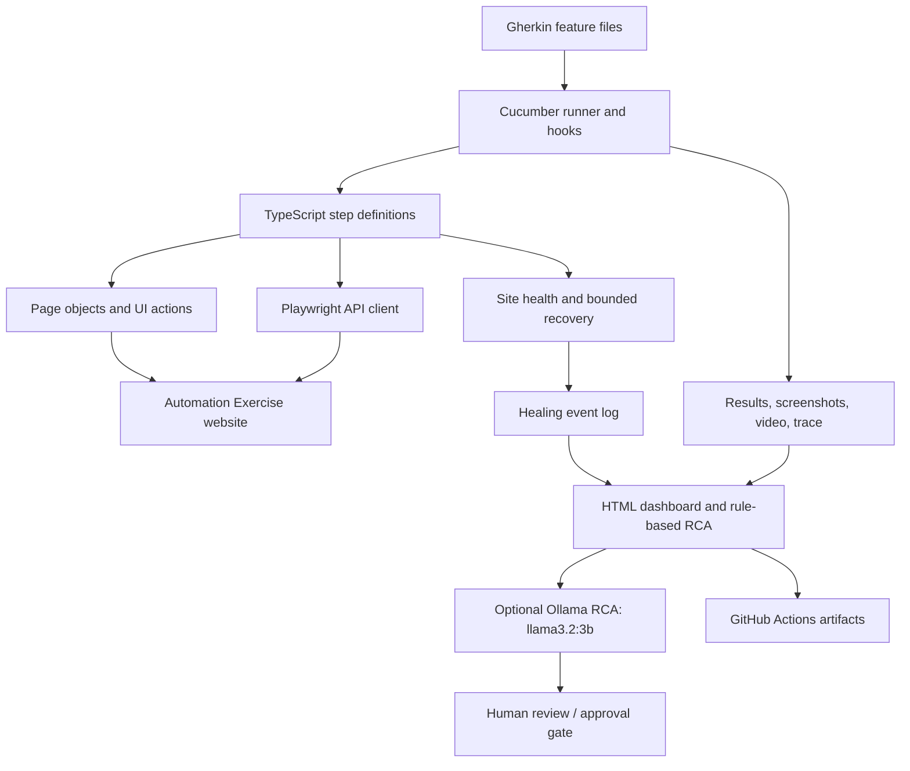

# AI Level-3 QA Automation | Playwright + Cucumber + Ollama

[](https://github.com/aslamgill326-netizen/qa-ai-level3-cucumber/actions/workflows/qa-automation.yml)

**System under test:** https://automationexercise.com  
**Repository:** https://github.com/aslamgill326-netizen/qa-ai-level3-cucumber  
**Stack:** TypeScript · Playwright · Cucumber.js (BDD) · Node.js · GitHub Actions · Ollama (`llama3.2:3b`)

## Overview

Risk-oriented UI and API automation for Automation Exercise, with reusable page objects, Gherkin scenarios, bounded self-healing, Cucumber evidence, HTML execution dashboards, and advisory AI root-cause analysis (RCA).

**Observed local regression result (20 Nov 2026):** 26 scenarios passed, 0 failed, 152.2 seconds. This is one observed run, not a reliability guarantee. A GitHub Actions PR run also showed success; see Actions for the authoritative job logs and artifacts.

## Prerequisites

- Git
- Node.js **22** (matches CI) and npm
- VS Code (optional)
- Internet access to the public test website
- Chromium browser binaries installed by Playwright
- **Optional for local AI RCA:** Ollama and `llama3.2:3b`
- **CI only:** GitHub Actions; FFmpeg and Ollama are installed by the workflow

Check your installation:

```powershell
git --version
node --version
npm --version
```

## Quick start

```powershell
git clone https://github.com/aslamgill326-netizen/qa-ai-level3-cucumber.git
cd qa-ai-level3-cucumber
npm ci
npx playwright install chromium
npm run typecheck
```

`npm ci` requires the committed `package-lock.json`.

## Test commands

| Goal | Command |
|---|---|
| Full local regression (excluding controlled failure) | `npm run test:dashboard -- --tags "not @rca-validation"` |
| UI tests | `npm run test:ui` |
| API tests | `npm run test:api` |
| Smoke tests | `npm run test:smoke` |
| Authentication tests | `npm run test:auth` |
| One named scenario | `npm run test:dashboard -- --name "Valid login and logout"` |
| TypeScript validation | `npm run typecheck` |
| Generate legacy summary report | `npm run report` |
| Controlled RCA validation only (**expected failure**) | `npm run test:dashboard -- --tags "@rca-validation"` |
| CI regression | `npm run test:ci -- --tags "not @rca-validation"` |

> **Check your checked-out `package.json`:** `test:ci` is used in the supplied workflow, but it was absent from an earlier shared package.json snapshot. If `npm run test:ci` is missing, inspect the latest scripts (`npm run`) and reconcile the workflow before relying on this command. Commands that use `test:dashboard -- --tags ...` also depend on the dashboard runner forwarding arguments to Cucumber.

The `@rca-validation` scenario deliberately asserts a missing locator to exercise failure reporting. **Do not include it in the standard green regression.** A failing validation run is expected and must not be presented as a product defect.

## Architecture



**Key implementation paths** (confirm against the repository):

```text
features/                         # UI and API Gherkin scenarios
src/steps/                        # Cucumber step definitions
src/support/world.ts              # Per-scenario context
src/utils/selfHealing.ts          # Bounded navigation / locator recovery
src/utils/siteHealth.ts           # Detect overload and HTTP errors
tools/report/                     # Dashboard and RCA generation
reports/cucumber/                 # HTML/JSON and screenshots
.github/workflows/qa-automation.yml
```

## Self-healing policy

- Detect known 429/5xx responses and server overload pages.
- Retry **safe, repeatable** GET navigations and API requests with bounded backoff.
- Use approved locator alternatives, not arbitrary selectors.
- **Do not blindly repeat** registration, Add to Cart, payment, or other state-changing requests.
- Verify resulting state after recovery; preserve genuine assertion failures.
- Record recovery attempts for reporting and diagnosis.
- If the public website remains unavailable, classify the run as environment-blocked/failed, **never falsely passed**.

## Reporting, screenshots and video

The framework generates Cucumber and dashboard artifacts under `reports/`. Failure screenshots and available video/trace evidence depend on the active hooks and Playwright context configuration. Inspect the actual artifact ZIP to confirm video files are present; uploading `reports/`, `test-results/`, and `playwright-report/` does not create recordings by itself.

Typical report locations:

```text
reports/cucumber/test-execution-results.html
reports/cucumber/results.json
reports/cucumber/ai-rca.json
reports/cucumber/ai-rca.html
reports/cucumber/screenshots/
```

Some files are produced only when the corresponding reporting step runs.

## Ollama and AI-assisted RCA

The CI workflow configures:

```text
AI_RCA_ENABLED=true
AI_RCA_PROVIDER=ollama
AI_RCA_MODEL=llama3.2:3b
OLLAMA_BASE_URL=http://127.0.0.1:11434
AI_RCA_ALLOW_CLOUD=false
```

For local use, install Ollama and pull the model:

```powershell
ollama pull llama3.2:3b
ollama list
```

Ollama serves the model locally. The RCA script may send **sanitized failure categories and step-status metadata**, not credentials or raw private evidence. It can return a hypothesis, alternative explanation, confidence and suggested next action. AI output is **advisory** and requires human review; it does not autonomously fix code or approve merges. When there are no failures, zero AI findings is expected.

## GitHub Actions CI/CD

Workflow: [`.github/workflows/qa-automation.yml`](.github/workflows/qa-automation.yml)

Triggers:
- Pull requests targeting `main`
- Pushes to `main` or `feature/github-actions-cicd`
- Manual `workflow_dispatch`
- Daily `cron: '0 0 * * *'` = **05:00 Pakistan Standard Time** (00:00 UTC)

**Note:** GitHub schedules use the repository's default branch and may be delayed. A green PR run does **not** prove the scheduled trigger has executed.

Pipeline sequence: checkout → Node 22 → `npm ci` → Chromium → FFmpeg → Ollama startup and model pull → typecheck → Cucumber regression → RCA/dashboard fallback → job summary → artifact upload → enforce original test/typecheck status.

Download evidence: **Actions → select run → Artifacts → `qa-reports-<run_id>`**. Artifacts are configured for **14 days** retention.

## Test strategy and submission

The assignment's **Section 14** requires more than a README. See [`SUBMISSION_CHECKLIST.md`](SUBMISSION_CHECKLIST.md) for the complete evidence matrix, open gaps, and proposed submission structure. It requires a strategy/risk matrix, traceability, architecture, tests/fixtures, CI evidence, AI artifacts, two injected-failure RCA reports, quality scorecard, and presentation/live defense.

## Known limitations and safety

- External public website can intermittently return overload/503 responses.
- Passing once does not establish flake-free behavior; track reruns and healing events.
- Do not commit `.env`, secrets, disposable user credentials, raw sensitive logs or large generated reports.
- Disposable test accounts require cleanup evidence; verify implementation and document any limits.
- Model name shown in a report is not proof of a completed inference; confirm logs/JSON.
- Do not claim an intentionally injected locator failure is a real application bug.
- Do not allow AI to push to protected branches, change secrets, or merge without approval.

## Contributing / running a PR

```powershell
git switch -c docs/assignment-submission
git add README.md SUBMISSION_CHECKLIST.md
git commit -m "docs: document framework and assignment submission"
git push -u origin HEAD
```

Create a PR to `main`; review the GitHub Actions check and its artifacts before merging.

---
**Project status:** Local green run evidenced; PR pipeline green in supplied screenshot; scheduled-run evidence, two distinct injected RCA examples, and quantitative quality metrics must be verified before claiming full assignment completion.
