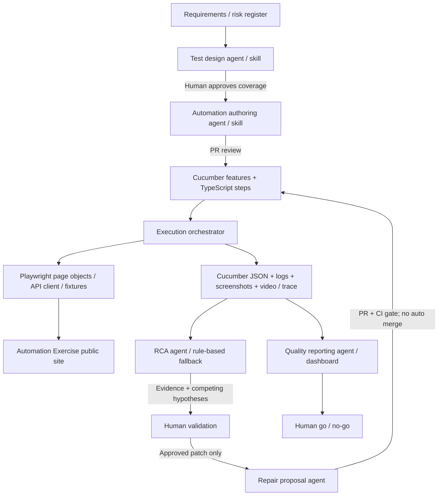

# QA Framework and AI Capability Architecture
**Status:** Proposed responsibility map based on the assignment and supplied project evidence. Do not claim all agents are executable until demonstrated.

## Six required responsibilities and stop conditions
| Responsibility | Inputs | Outputs | Stop condition / human checkpoint |
|---|---|---|---|
| Test design | Requirements, risks, mappings | Traceable cases, oracle questions | Coverage approved |
| Automation authoring | Approved cases, page model | TS code, fixtures, assertions | PR review + CI gate |
| Execution orchestrator | Tags, environment, commit | Status, artifacts, healing events | No changes to live site |
| RCA | Error, stack, trace, console, network, diff | Classified hypotheses and confidence | Reviewer validates evidence |
| Repair proposal | Validated RCA, code diff | Minimal patch proposal + test plan | No autonomous merge |
| Quality reporting | Results, trends, RCA | Scorecard and release recommendation | Human owns release decision |

## Observed implementation vs proposed interfaces
**Observed from supplied evidence:** Cucumber BDD tests, Playwright/TypeScript, site-health and recovery helpers, HTML dashboard, rule-based RCA, Ollama model configuration, GitHub Actions artifact upload and final status enforcement.

**Not independently verified:** fully autonomous multi-agent orchestration, typed API clients and isolated fixtures, automated repair branches, exact screenshot/video retention, all six agent handoffs, prompt-injection test. Demonstrate or label these as proposed.

## Data and evidence contract
Run metadata: run ID, UTC timestamp, commit SHA, scenario ID, risk priority, test status, error stack, screenshot/trace paths, retry/healing events, model version, reviewer decision. Scrub credentials and personal fields before model use. Preserve test status even if RCA generation fails.

## Failure-safe boundaries
No AI-driven arbitrary shell commands, no unreviewed edits, no auto merge, no secret access from untrusted PR, no retry of unsafe registration/cart/payment operations, no silent assertion weakening.
